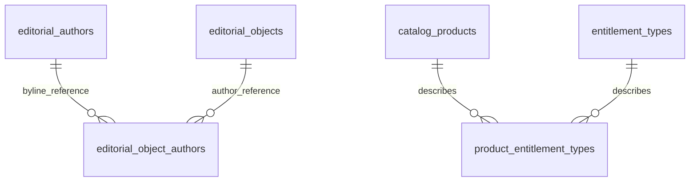

# PostgreSQL foundation (P1-09)

This is a **local development** database for reference metadata and future schema work. Public Hugo articles, build, URLs and search remain static and work with PostgreSQL stopped. No hosted project, login, payment or customer processing is implemented. Do not use the demo credentials or container configuration in production.

## Boundaries



`editorial_objects` holds opaque UUIDs, stable `content_key` and an editorial kind; article bodies and public URLs remain in Hugo. `editorial_authors` holds reference labels, not user accounts. `catalog_products` and `entitlement_types` are definitions only; their join does not grant access. There are no member identities, orders, payment events, or actual entitlements. Demo data is synthetic.

A future reviewed front-matter field may map a stable `content_key` to one DB reference; changing a URL or translation must not change that key. Do not add IDs to current articles or depend on database reads for Hugo builds as part of this foundation. Decide the identity/translation mapping and lifecycle before actual synchronization.

## Start, migrate and seed

Requires Docker with Compose v2. From repository root:

```sh
# Optional: copy db/.env.example to ignored db/.env and edit local-only values.
db/bin/compose up -d --wait
db/bin/migrate
db/bin/migrate  # no-op: already-applied versions are verified, not replayed
# Optional synthetic demo rows; run only against an empty/disposable local DB.
db/bin/compose exec -T db sh -c 'exec psql -X -v ON_ERROR_STOP=1 -U "$POSTGRES_USER" -d "$POSTGRES_DB"' < db/seed.sql
```

The service is bound to `127.0.0.1:55432` by default. `db/.env` is ignored; its example contains deliberately non-secret local defaults. A named Docker volume persists across ordinary `db/bin/compose down`. Changing PostgreSQL initialization credentials after the first start does not reinitialize an existing volume. The local owner is a superuser, suitable for isolated demos only. Never connect this runner to a hosted/production database.

`db/bin/compose` selects the project Compose file from any working directory and loads `db/.env` when present. The migration runner requires gap-free, lexically ordered `NNN_name.sql` files starting at `001`. It computes SHA-256, holds a PostgreSQL advisory transaction lock, validates the complete recorded history, and applies all pending files and ledger inserts in one transaction. Unknown, missing, reordered or modified applied migration files cause failure; do not alter an applied file. No `BEGIN`/`COMMIT` belongs inside migrations. For changes, add a new migration; recover through a reviewed compensating migration or verified backup/restore, not ledger edits. SQL files and local migration directory override are trusted developer inputs, not a public API.

## Backup and restore drill

The integration test below uses a unique disposable project and volume and verifies restoration into a fresh database. Do not run deletion commands against a valuable volume. For a manual drill, first choose a **new, disposable** project name and use only synthetic seed data:

```sh
export COMPOSE_PROJECT_NAME=ted_p109_restore_demo
export P1_POSTGRES_PORT=55438
db/bin/compose up -d --wait
db/bin/migrate
db/bin/compose exec -T db sh -c 'exec psql -X -v ON_ERROR_STOP=1 -U "$POSTGRES_USER" -d "$POSTGRES_DB"' < db/seed.sql
db/bin/compose exec -T db sh -c 'exec pg_dump -U "$POSTGRES_USER" -d "$POSTGRES_DB" -Fc' > /tmp/ted-p109-demo.dump
db/bin/compose exec -T db sh -c 'createdb -U "$POSTGRES_USER" p109_restore_check'
db/bin/compose exec -T db sh -c 'exec pg_restore -U "$POSTGRES_USER" -d p109_restore_check --exit-on-error' < /tmp/ted-p109-demo.dump
db/bin/compose exec -T db sh -c 'exec psql -X -v ON_ERROR_STOP=1 -U "$POSTGRES_USER" -d p109_restore_check -c "SELECT content_key FROM editorial_objects; SELECT version FROM schema_migrations;"'
# Only for the disposable project above: removes its database volume permanently.
db/bin/compose down --volumes
```

Backups may contain sensitive data in future; store them with appropriate access controls, retention, encryption and tested recovery. The demo dump in `/tmp` is unencrypted and must not contain real data. Delete that demo file when finished. Restore roles/ownership separately for a future deployment; the local drill does not validate production disaster recovery.

## Security and later rollout

Do not publish database credentials in Git, generated HTML or browser code. For any future hosted PostgreSQL/Supabase deployment, the maintainer must choose the account, region, costs, retention, encryption and backup/export strategy first. Use separate least-privilege migration and application roles, revoke unnecessary public privileges, and configure/test row-level security before exposing tables through any public data API. Future authorization and verified payment webhooks require a trusted backend and separate approval; neither the metadata model nor client-side hiding enforces access. Review personal-data retention/deletion and cross-border handling before adding real people. There are no real user records in this foundation.

## Validation

Run `db/tests/integration.sh` and the Hugo production build. The tests use their own disposable Compose project and volume; their teardown must never target your normal development project. Check `docs/AGENT_LOG.md` for actual commands, test outcomes and any remaining limitations.
