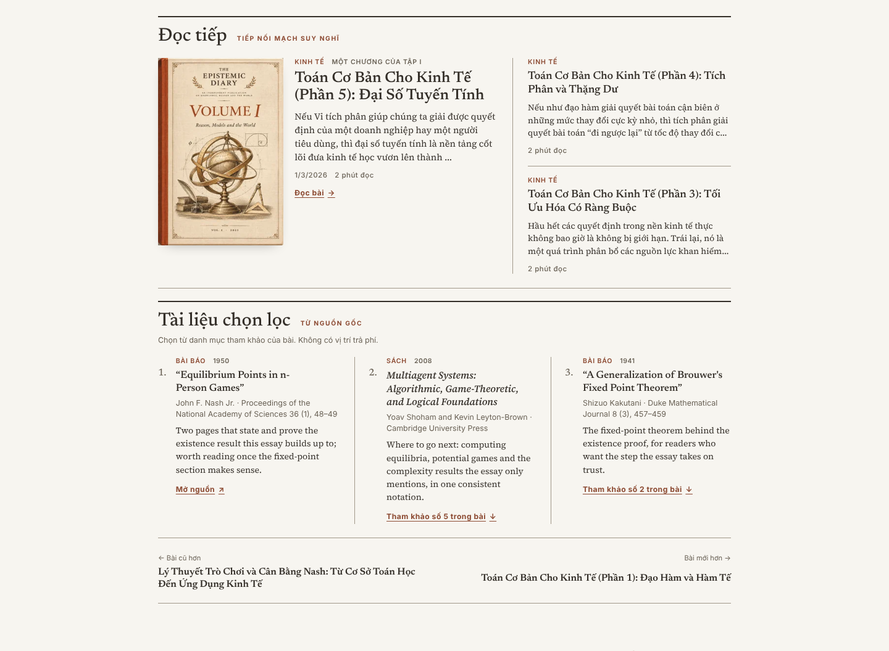

# D1 Article Reading — implementation evidence

## Final acceptance pass (Claude Code, 2026-11-23)

**Status: READY FOR OWNER APPROVAL TO MERGE — not merged, not deployed.** Branch `feat/d1-article-reading`, PR #40. Commits in this pass: `b5c419e`, `27e046f`, `ccb5556`, plus the commit adding this section. Scope: close D1 only (bugs, accessibility, localisation, evidence). No layout redesign, no new modules.

The owner handoff (`PHASE4_D1_CODEX_HANDOFF.md`) and `D1_APPROVED_REFERENCE.png` were available in the owner's workspace for this pass (untracked, not committed) and were read and viewed. The owner decided on 2026-11-23 that the brand mark, favicon and navigation flourishes stay in D1 as interim identity, to be replaced in D5 (DECISIONS D-016).

### Defects found and fixed

| # | Finding (how it was found) | Fix |
|---|---|---|
| 1 | **Contents rail clipped on 1111–1320 px screens (1280 px laptops).** The rail was positioned against a 44rem column, but the prose is 70ch = 39.375rem, so its left edge sat up to 80 px outside the article and the first characters of every entry were cut off. Seen in a 1280 px screenshot. The harness tested only 1440 and 1024, so it missed this. | The rail ends one gap before the real prose edge and starts no further left than the article. It narrows (165 px at 1112) instead of being cut. Prose boxes are identical to before at 390, 600, 700, 900, 1024, 1112 and 1440 px. New harness check covers 1112–1920. [before](final/screenshots/before-1280-rail-clipped.png) / [after](final/screenshots/after-1280-rail.png) |
| 2 | **Orca said "N percent" during reading.** The progress bar was `role=progressbar`, so every scroll made Orca interrupt with "28 percent", "88 percent"… (7 times in the [before transcript](final/evidence/orca-before-fix-speech.txt)). | Visual only (`aria-hidden`). The contents list already exposes the current section through `aria-current`. 0 occurrences in the [after transcript](final/evidence/orca-after-fix-speech.txt). |
| 3 | TOC toggle names were English on every language ("Toggle subsections for …"). | `ed_tocToggle` in i18n. Orca reads "Mục con của 3. Dominant Strategies… collapsed push button", then "expanded" / "collapsed" as it is pressed. |
| 4 | Contents was a labelled `aside` wrapping an unlabelled `nav`, i.e. two nested landmarks. | One landmark: Hugo's `<nav>` carries the label ("Nội dung"). The aside has none. |
| 5 | Discovery kickers came before their headings in the DOM, so Orca read "Tiếp nối mạch suy nghĩ" before "Đọc tiếp". | Heading first in the DOM. The visual order is unchanged. |
| 6 | Two Curated Reading entries linked only to the essay's own reference list, because they could not be verified offline. | Verified on 2026-11-23: Kakutani DOI `10.1215/S0012-7094-41-00838-4` against Crossref (Duke Math. J. 8(3) 457–459, 1941) and doi.org (resolves to Project Euclid). `masfoundations.org` is the authors' official site for *Multiagent Systems* and offers the free eBook in agreement with Cambridge University Press. |
| 7 | After #6, the three links were all named "Mở nguồn". | Each link carries its source title as screen-reader text, e.g. "Mở nguồn: Equilibrium Points in n-Person Games". |
| 8 | Doubled rules: a Markdown `---` before a section heading plus the h2's own rule; the TOC border under the progress bar; the mobile panel border plus the TOC border. | One rule each. |
| 9 | Vietnamese wording: "Từ nguồn gốc" and "liên kết tiếp thị liên kết". | "Từ nguồn trích dẫn"; "liên kết affiliate (tiếp thị liên kết)". |

### Screen reader (real Orca, not simulated)

- **Setup:** Orca 46.1 with Google Chrome (`--force-renderer-accessibility`). Both ran on an isolated nested X display (Xephyr `:99`) with their own D-Bus and AT-SPI buses and no audio sink, so the owner's desktop session was not touched. Keys were synthesised via AT-SPI (XTest) and received by Orca like keyboard input. Orca's debug log records every utterance, and the transcripts are excerpts of it.
- **Why not Firefox:** the system Firefox is a snap, and AppArmor blocks AT-SPI clients started from this environment from reading its accessibility tree. **Firefox + Orca therefore remains untested.** Chrome exposes the same ARIA semantics through AT-SPI, but the two browsers do not behave identically.
- **Covered:** browse-mode heading navigation (H), landmark navigation (M), Tab order through header, TOC and footer, toggle operation with Space, and the footer links in reverse.
- **Heard:** "navigation Nội dung", "region Đọc tiếp", "region Tài liệu chọn lọc", "navigation Bài cũ hơn và mới hơn". Every essay link is announced once.
- **Not covered:** mobile layout under a screen reader, and NVDA/JAWS/VoiceOver.

Pre-existing issues heard, outside D1 (recorded, not changed):
- English essays on Vietnamese pages are marked `lang="vi"`, so Orca reads English prose with a Vietnamese voice. This is a content-language metadata question for D4.
- MathJax output is read symbol by symbol ("𝐺 = ( 𝑁 , …"). Math accessibility belongs to D2.
- Every heading is followed by its permalink anchor, "Liên kết tới mục này: …".
- The masthead strip reads "…VÀ THẾ GIỚITOÁN HỌC · KINH TẾ…" with no pause between its two halves.

### Verification on the final tree (exit 0)

| Check | Result |
|---|---|
| Clean build of the committed tree (`hugo --gc --minify`) | 0 warnings, 0 errors. A local, git-ignored `content/khoa-hoc-may-tinh/kalman-test*.md` draft breaks a build of the working copy; it is not in the repository and CI is unaffected. |
| `node scripts/test-d1.cjs` → [d1-results.json](final/evidence/d1-results.json) | **29/29 PASS** (25 earlier checks + rail 1112–1920 px, screen-reader structure, distinct source links, no doubled rules); axe-core 4.10.2 0 violations |
| `node docs/audits/p3-07/tools/p3-smoke.cjs` → [p3-smoke-results.json](final/evidence/p3-smoke-results.json) | **32/32 PASS**, axe 0 serious/critical |
| Route parity vs `main` | HTML/XML/JSON route lists identical; `index.xml`, `sitemap.xml` and `en/index.xml` byte-identical |
| Visual review against the approved reference | Viewport-centred prose, left rail with progress and a plant below it, centred navigation with flourishes, brand mark, branch headpiece, and two stacked equal-width discovery modules. All present. See the open item below. |

Screenshots: [final/screenshots/](final/screenshots/).

### Open for the owner (product decision, not a defect)

- **Right-side balance.** The handoff records the owner's own critique that an empty right side can feel awkward, and allows a restrained *background* ornament there. The current build leaves the right side empty at all widths. Adding one needs new artwork, which is D5 territory.

## Phase 4 refinement and visual acceptance (Claude Code, 2026-11-22)

**Status: READY FOR OWNER VISUAL REVIEW — not merged, not deployed.** Branch `feat/d1-article-reading`, on top of `origin/main` `c2898aa`. Commits: implementation `e2033a1`, test harness `33195bf`, this report and evidence: see the commit that adds `docs/audits/d1/refinement/` (hash in the PR description). The earlier pass by Codex is kept below; where it disagrees with this section, this section is current.

The handoff files named in the brief (`PHASE4_D1_CODEX_HANDOFF.md`, `D1_APPROVED_REFERENCE.png`) are not in the repository or this workspace, so the refinement was judged against the brief itself, the existing D1 branch and D-016.

### Requested end-of-article view (1440 px)

| Before (previous D1) | After, light | After, dark |
|---|---|---|
| [PNG](refinement/screenshots/before-d1-1440-light-footer-full.png) | [PNG](refinement/screenshots/nash-1440-light-footer-full.png) | [PNG](refinement/screenshots/nash-1440-dark-footer-full.png) |

### Defects found in the previous D1 state and what changed

| # | Finding (evidence) | Change |
|---|---|---|
| 1 | **Contents rail scrolled away.** At 10/25/50/75/98 % of the Nash essay the TOC was 447–7,590 px above the viewport ([probe](refinement/evidence/before-sticky-probe.json), [screenshot](refinement/screenshots/before-d1-1440-sticky-50.png)). The absolutely positioned aside was only as tall as its content, so its sticky children had nowhere to travel. | The aside spans the article body (`top`/`bottom` of `.article-layout`); one sticky `.toc-panel` holds progress, TOC and plant, with its own scroll when the list is taller than the viewport. In view at every tested position at 1440×900 and 1280×720. |
| 2 | **H3 lists never folded** (two to five sections open by the end). | Active entry = last heading above 30 % of the viewport, recomputed on scroll (correct in both directions and after a deep link); its section opens and the others fold, except sections the reader toggled (kept as set). The active entry is kept visible inside the panel. Toggles now sit on the H2's line instead of wrapping below it. |
| 3 | **Further Essays was a plain three-column text grid**, headings hard-coded in English on Vietnamese pages. | Featured card + up to two supporting essays (below). Headings, kickers and CTAs localised (`ed_furtherEssays`, `ed_curatedReading`, …; ja/zh-CN carry English like the rest of their interface). |
| 4 | **Curated Reading had one record** in a different visual weight. | Same width and rule weight as Further Essays, a bibliographic layout (numbered, paper/book, authors · source, why it follows from the essay). |
| 5 | **Duplicate footer navigation**: the "Related reading" list repeated Further Essays. | Removed. Older/newer stays (chronological, a different purpose) and its two essays are excluded from Further Essays, so no essay appears twice. |
| 6 | **Paper texture behind the whole page**, including prose and equations; it also made axe unable to compute text contrast (Codex recorded 225–235 `color-contrast` incomplete nodes per state). | Removed. Incomplete contrast items fell to 3–14 per state, all glyph icons (see below). |
| 7 | **Ornaments fixed brown** in both themes; rotation was `len(path) mod 2`; masthead branches were clipped to a sliver by the masthead's overflow and sat behind the page background (invisible). | SVGs inlined with `currentColor` (follow the accent token per theme); md5-based pick per article and role, front-matter override; a small mirrored branch headpiece above the title replaces the masthead corners. Homepage carries no D1 ornament. |

### Further Essays

- Candidates: Hugo's related content in the main sections, minus the current essay and the older/newer essays; first three kept.
- Featured: the first candidate that already owns artwork, resolved by `layouts/_partials/editorial/page-art.html` in this order: front matter `art` (a `data/art.yaml` key) → the homepage curation in `data/home.yaml` → the cover of the volume the essay is a chapter of (shown whole, as a book, with "A chapter of Volume I"). No generic or decorative image is ever substituted; with none, the card is text-only with an accent rule. Titles, summaries and dates come from the essays.
- On the Nash essay this yields *Toán Cơ Bản Cho Kinh Tế (Phần 5)* with the Volume I cover, plus parts 4 and 3. The three candidates are all Volume I chapters, which reflects the related-content index, not a choice.

### Curated Reading

`data/d1_resources.yaml` (documented schema in the file). For the Nash essay, three entries from the essay's own reference list:

| Entry | Link | Why no other link |
|---|---|---|
| Nash (1950), *PNAS* 36(1) 48–49 — paper | `https://doi.org/10.1073/pnas.36.1.48` (already in the previous D1 record; DOI matches volume/page) | — |
| Shoham & Leyton-Brown (2008), Cambridge University Press — book | "Reference 5 in this essay" → `#references` | An author-hosted edition exists by reputation, but doi.org and the host are not reachable from this environment, so nothing was verified. No cover: none with a confirmed reuse right. |
| Kakutani (1941), *Duke Math. J.* 8(3) 457–459 — paper | "Reference 2 in this essay" → `#references` | DOI not verifiable here. |

No price, rating, merchant, purchase wording or affiliate link. The schema has `affiliate: false`; a future `true` renders a separate "Disclosure" line and is not mixed into the note. The `why` notes are English, like the essay itself, and marked `lang="en"`.

### Ornament placement (prototype artwork)

`data/d1_ornaments.yaml`: five repository-authored line drawings, **status: prototype** (not final; library expansion is D5). Placement: navigation `❧` flourishes either side of the section links (sitewide header, unchanged from the earlier D1 pass); a mirrored branch headpiece above the article kicker (opacity .4); one plant below the contents rail on wide screens with enough height (hidden under 760 px viewport height, 1110 px width); one faint landscape strip below the footer (opacity .26, hidden under 560 px). Nothing behind prose, equations, tables or the discovery cards. Rotation: md5 of the content path, so translations share artwork and a reload or rebuild never changes it; any new entry with an existing role widens the rotation; `ornaments: { toc: …, landscape: … }` in front matter pins a file (unknown names warn at build).

### Verification (all on the final tree, exit 0)

Build: `hugo --gc --minify` — 0 warnings, 0 errors. Browser: Playwright 1.63.0 with its own Chromium, certificate validation on (MathJax now loads from cdn.jsdelivr.net normally; the earlier `D1_IGNORE_HTTPS_ERRORS` workaround was not used).

| Check | Command / evidence | Result |
|---|---|---|
| D1 harness, 25 checks | `D1_BASE=http://127.0.0.1:1338 D1_OUT=… D1_AXE=…/axe.min.js node scripts/test-d1.cjs` → [d1-results.json](refinement/evidence/d1-results.json) | **25/25 PASS** |
| Centring | same | prose centre − viewport centre: −0.01 px at 1440 and 1024, 0.00 px at 390, light and dark; header and footer share that centre (±2 px); navigation centred ±2 px at 1440 |
| Sticky TOC / progress | same, 10/25/50/75/98 % at 1440×900 and 1280×720 | panel fully in view at all ten positions; active entry equals the heading being read and is visible in the panel; ≤ 1 section open; progress 10→25→50→75→98 |
| Manual toggle, deep link, keyboard | same | hand-opened section stays open while reading elsewhere; `#4-nash-equilibrium` lands at the heading and marks §4; Tab order starts with the skip link, reaches TOC links and toggles, every stop shows an outline; footer links have no duplicate stops |
| Other essays | same: `/kinh-te/toan-co-ban-1/` (vi), `/en/kinh-te/game_theory_nash/`, Riemann vi/en at 1440 and 390 | 200, centred, no overflow, tables and display math inside the viewport, MathJax 0 errors, body ≥ 16 px |
| 200 % text | root font-size doubled at 390 and 1440 | no horizontal page scroll, prose inside the viewport |
| axe-core 4.10.2, WCAG 2.1 A/AA | 3 essays × 390/1440 × light/dark | **0 violations** |
| Manual contrast review | axe `incomplete` = 3–14 nodes per state (3 on a short essay, 10 on Nash, 14 on Riemann), all `nonBmp` glyphs: `❧` flourishes (decorative, `aria-hidden`), TOC chevrons, arrow glyphs. Tokens measured: muted 5.52:1 / 6.42:1, accent 6.14:1 / 7.83:1 (light / dark) | pass (≥ 3:1 non-text, ≥ 4.5:1 text). Ornaments are decorative and hidden from assistive technology |
| Phase 3 regression | `BASE=… AXE=… MATRIX_SHOTS=0 node docs/audits/p3-07/tools/p3-smoke.cjs` → [p3-smoke-results.json](refinement/evidence/p3-smoke-results.json) | **32/32 PASS**, 100 states, axe 0 violations |
| Route parity vs `main` | [route-parity.json](refinement/evidence/route-parity.json) | 410 = 410 HTML/XML/JSON/MD routes, none added or removed; every XML and JSON file (feeds, sitemaps, search indexes) byte-identical. Other files: hashed CSS/JS renamed; favicon and five ornament SVGs added |
| Performance (local, unthrottled, one run; not field CWV) | `node docs/audits/p3-07/tools/perf.cjs` → [vs main](refinement/evidence/performance-main-vs-refined.json), [vs previous D1](refinement/evidence/performance-d1-previous-vs-refined.json) | see below |

| Page (1440 and 390 identical) | `main` | previous D1 | refined D1 | Requests | CLS |
|---|---|---|---|---|---|
| Home | 743 KB | 752 KB | 754 KB | 17 | 0 |
| Nash essay | 762 KB | 775 KB | 781 KB | 23 | 0 |
| Short essay (`toan-co-ban-2`) | 526 KB | 538 KB | 562 KB | 16 | 0 |

The refined stylesheet is +9 KB over `main` (all pages). A short essay also loads the 256 px featured cover (20 KB) because the footer is near the first viewport; LCP stays 56–112 ms. The earlier report's "431 KB vs 804 KB" was measured differently (response headers) and is not comparable.

Screenshots ([all](refinement/screenshots/)): Nash at 1440/1024/390 × light/dark at article start, middle and footer; full footer captures; sticky rail at 50 % and 98 %; Vietnamese, English and Riemann essays at 1440/390; 200 % text at 390/1440.

### Files changed in the refinement

`layouts/_partials/editorial/article.html`, `d1-discovery.html`, `d1-ornament.html`, new `d1-ornament-pick.html` and `page-art.html`; `layouts/_partials/site/masthead.html` (branches removed); `assets/css/editorial/d1.css`; `assets/js/editorial.js` (TOC section only); `data/d1_resources.yaml`; `data/d1-ornaments.yaml` → `data/d1_ornaments.yaml`; `i18n/{vi,en,ja,zh-CN}.toml` (+13 keys); `static/ornaments/d1/paper.svg` removed; `scripts/test-d1.cjs`. Homepage templates, payment, subscription, affiliate infrastructure and D2–D8 untouched.

### Remaining issues and limits

- **Ornaments are prototypes.** Simple line art; the owner has not approved them as final. Five files only (D5 expands the library).
- **Curated Reading exists for one essay.** Other essays show Further Essays only, by design, until verified entries are added.
- **Two references link inward**, not to the source, until their DOIs/host can be verified from a networked machine.
- **Further Essays on Nash shows three Volume I chapters**; the related index has little else that is related. More tagged content will diversify it.
- The `why` notes are English on the Vietnamese page (the essay itself is English).
- TOC toggle labels ("Toggle subsections for …") are English in all languages (inherited from the earlier pass).
- Visual review against an approved reference image was not possible (file not provided). Screen-reader testing was not performed; automated checks are not a conformance claim.
- No live deployment or live-site check: merge and deploy are the owner's call.

---

## Earlier pass (Codex, 2026-11-16)

## Status

**READY FOR PR REVIEW — not deployed or merged.** This implements D1-00 through D1-06 only. D2–D8 remain future constraints, and no homepage, payment, affiliate, subscription, or other product architecture was changed. The branch is pushed; automated PR creation is blocked by GitHub API `403 Forbidden`, so use the remote branch’s compare link to open the focused PR manually.

Baseline: `origin/main` `c2898aa`; implementation branch: `feat/d1-article-reading`; claim `e8a38a0`; implementation `aa8ae36`. The complete owner handoff and approved reference were read/inspected before any code modification.

## What changed

- The long-form article’s prose now centres on the viewport at wide widths; its independent TOC rail sits to the left, becomes normal flow before collision at tablet width, and becomes a compact disclosure on mobile.
- The TOC has persistent top-level entries, manual H3 disclosure controls, contextual opening only until a reader takes manual control, and a prose-only reading-progress indicator.
- The masthead uses a reusable vector brand mark, independently centred navigation, symmetric low-contrast flourishes, plus a vector favicon.
- Original, repository-authored botanical/paper/landscape SVG ornaments are decorative (`alt=""`, `aria-hidden`) and deterministic per article. The optional ornamental files from the handoff were explicitly marked concept prototypes, so were not used.
- The end of an article starts with **Further Essays**, then **Curated Reading / Resources**. The sole resource record is the actual Nash (1950) PNAS paper linked at its DOI; it contains no price, affiliate, merchant, fake cover, or purchase claim.
- Display mathematics and tables use their own horizontal scroll region at extreme text scale rather than widening the reading page.

## Before / after

Representative route: `/kinh-te/game_theory_nash/`.

| Viewport | Before | After, light | After, dark |
|---|---|---|---|
| 1440 × 900 | [PNG](screenshots/before-nash-1440.png) | [PNG](screenshots/after-nash-1440-light.png) | [PNG](screenshots/after-nash-1440-dark.png) |
| 1024 × 768 | [PNG](screenshots/before-nash-1024.png) | [PNG](screenshots/after-nash-1024-light.png) | [PNG](screenshots/after-nash-1024-dark.png) |
| 390 × 844 | [PNG](screenshots/before-nash-390.png) | [PNG](screenshots/after-nash-390-light.png) | [PNG](screenshots/after-nash-390-dark.png) |

Before: prose centre was x=687.3 at 1440px and x=606.7 at 1024px because the TOC grid consumed left-side space. After: x=719.99/1440 and x=511.99/1024; at 390px it is x=195.00. The complete structured browser result is [browser-results.json](evidence/browser-results.json).

## Verification

| Check | Result |
|---|---|
| `PATH=/workspace/.cloud-tools/bin:$PATH npm run build -- --destination /tmp/d1-release-build` | PASS; 306 content pages, zero Hugo errors |
| D1 browser harness: `D1_BASE=http://127.0.0.1:1336 D1_OUT=/tmp/d1-release D1_IGNORE_HTTPS_ERRORS=1 D1_REQUIRE_MATH_RENDER=1 NODE_PATH=/tmp/p2-qa/node_modules:/tmp/p1-02-browser/node_modules node scripts/test-d1.cjs` | PASS: six light/dark states at 1440/1024/390, deep link, TOC manual state, progress, mobile/zoom, 68 MathJax containers/state, no console errors or horizontal overflow |
| 200% text scale, 390px | PASS; no page horizontal scroll; equations/tables retain internal scrolling |
| Vietnamese article `/kinh-te/toan-co-ban-2/` at 390/1440 | HTTP 200, Vietnamese text present, no horizontal overflow |
| axe-core at 390/1440 light/dark | 0 automatic WCAG 2.1 A/AA violations. `color-contrast` remained incomplete (225 mobile / 235 desktop nodes), so this is not a full manual accessibility sign-off. |
| Route retention | PASS: baseline and D1 each contain 377 HTML/XML/JSON outputs; exact relative-path lists are identical. |
| Local, unthrottled performance observation | D1: 431 KB same-origin response headers, 15–16 requests, FCP 352ms (390) / 268ms (1440), CLS 0. Baseline: 804 KB, 14 requests, FCP 280ms / 212ms. These are one-run local observations, not field CWV. |

The managed Chromium instance rejects the CDN certificate for MathJax with `ERR_CERT_AUTHORITY_INVALID` under its normal trust store. The formula-rendering run above uses its documented `D1_IGNORE_HTTPS_ERRORS=1` environment workaround only to test the existing third-party loader; it is not evidence of a live production certificate check. Direct live fetches were also unavailable here (`CONNECT 403`), so no deployment or live-site claim is made.

## Acceptance checklist

- [x] D1-00 baseline inspected and captures retained.
- [x] D1-01 centred, readable long-form article at desktop/tablet/mobile.
- [x] D1-02 independent, accessible TOC and prose-only progress.
- [x] D1-03 reusable identity, favicon, centred navigation, restrained ornaments.
- [x] D1-04 stable light/dark treatment and no automatic artwork inversion.
- [x] D1-05 real, non-commercial discovery data in the required order.
- [x] D1-06 build, route-retention, responsive, zoom, automated accessibility, and local performance evidence.
- [ ] Owner PR review / final approval.

No D1 task row exists in `docs/TASK_BOARD.md`; therefore this evidence does not alter unrelated Phase 1 or Phase 2 completion statuses.
